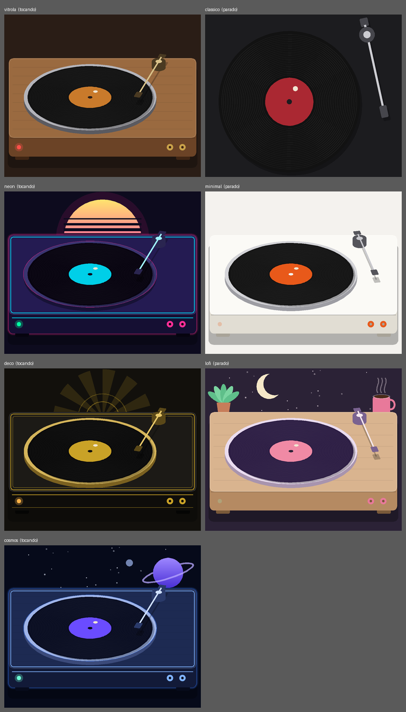

<div align="center">

# 💿 Vinyl Player

**A capa do seu álbum girando como um disco de vinil, numa vitrola de verdade.**

Tocador de música para **Windows** e **Linux** · 7 temas · mini player · rádios online

[**⬇️ Baixar a última versão**](../../releases/latest)

</div>

<p align="center"></p>

## ✨ Destaques

- 🎶 **Capa automática**: acha a capa dentro da música ou na pasta do CD e a faz girar no disco.
- 🪄 **Vitrola vista de lado**, com braço de agulha que desce quando a música começa e anda até o fim da faixa.
- 🎨 **7 temas completos**: Vitrola, Clássico, Neon Noturno, Minimal Branco, Art Déco Dourado, Lo-fi Café e Cosmos.
- 🪟 **Mini player** no canto da tela ao minimizar, com disco pequeno girando.
- 🔀 Aleatório, 🔁 repetir (lista ou uma música), pular, voltar, ±10 s, velocidade 0,75×–1,5×.
- 😴 **Timer de dormir** com fade do volume e **retoma de onde você parou**.
- 🌐 **Músicas da internet**: rádios online, listas `.m3u/.pls`, pastas de servidores (com subpastas), Dropbox e Google Drive.
- 🎭 **Modo palco** em tela cheia (F11).

## 📥 Como instalar

| Sistema | Baixe em [Releases](../../releases/latest) | Como usar |
|---|---|---|
| 🪟 Windows | `Vinyl-Player-Setup-….exe` | Dois cliques → Avançar → Concluir |
| 🪟 Windows (sem instalar) | `Vinyl-Player-Portatil-….zip` | Extrair e abrir `Vinyl Player.exe` |
| 🐧 Ubuntu / Debian | `vinyl-player_…_amd64.deb` | Dois cliques → Instalar |

> No Windows pode aparecer "O Windows protegeu seu PC": clique em **Mais informações → Executar assim mesmo**
> (acontece com qualquer programa sem assinatura digital paga).

## Como usar

1. Clique em **Abrir pasta / CD…** e escolha a pasta do CD ou álbum. A música começa a tocar
   e a **capa é encontrada sozinha**.
2. Ou simplesmente **arraste** a pasta, as músicas ou uma imagem de capa para dentro da janela.
3. Quer outra capa? **Visual → Trocar capa…** (ou arraste uma imagem). **Visual → Capa automática** volta ao normal.
4. Em **Visual**, marque **Capa ocupa o disco todo** se preferir a imagem cobrindo o disco inteiro.

| Tecla | O que faz |
|---|---|
| Espaço | Tocar / pausar |
| S | Ordem aleatória (liga/desliga) |
| R | Repetir: desligado → toda a lista → só esta música |
| Ctrl + → / Ctrl + ← | Próxima música / música anterior |
| Shift + → / Shift + ← | Avançar / voltar 10 segundos |
| Ctrl + O | Abrir pasta / CD |
| M | Mudo |
| F11 / Esc | Modo palco (entrar / sair) |
| F1 | Sobre |

### Pular, voltar, aleatório e repetir

Os botões ficam embaixo do disco, da esquerda para a direita:

| Botão | O que faz |
|---|---|
| 🔀 Aleatório | Toca as músicas em ordem sorteada, sem repetir nenhuma até todas tocarem. O botão fica aceso quando está ligado. |
| ⏮ Anterior | Depois de 3 segundos de música, **recomeça** a faixa; no começo dela, vai para a anterior (no aleatório, volta para a que tocou antes). |
| ⏪ −10 s | Volta 10 segundos dentro da música. |
| ▶ / ⏸ | Tocar / pausar. |
| ⏩ +10 s | Avança 10 segundos. |
| ⏭ Próxima | Pula para a próxima música (no aleatório, uma sorteada). |
| 🔁 Repetir | 1º clique: repete **toda a lista**; 2º clique: repete **só esta música** (aparece o número 1); 3º clique: desliga. |

O programa lembra se o aleatório e o repetir estavam ligados na próxima vez que abrir.

### Temas e menus

Todo o programa tem menus no alto da janela: **Arquivo, Reprodução, Visual e Ajuda**.
Em **Visual → Tema** há 7 visuais completos (cores, vitrola, ícones e mini player mudam juntos):

| Tema | Como é |
|---|---|
| **Vitrola** (padrão) | Vitrola de madeira vista de lado, prato metálico, braço que desce, luz vermelha |
| **Clássico** | O visual escuro original, disco visto de cima |
| **Neon Noturno** | Synthwave: sol rosa atrás da base, filete ciano e brilho neon |
| **Minimal Branco** | Tema claro e limpo, base branca e detalhes laranja |
| **Art Déco Dourado** | Preto e ouro, raios em leque e filete duplo |
| **Lo-fi Café** | Noite aconchegante: lua, xícara fumegante e planta ao lado da vitrola |
| **Cosmos** | Estrelas, planeta com anel e brilho azul |

O tema vale também para o mini player e fica salvo para a próxima vez.

### Mais recursos

| Recurso | Onde |
|---|---|
| **Velocidade** 0,75× a 1,5× (o disco gira junto) | Reprodução → Velocidade |
| **Timer de dormir**: a música baixa devagar e para | Reprodução → Timer de dormir |
| **Continua de onde parou** ao abrir de novo | automático |
| **Procurar na lista** | caixa acima da lista |
| Remover música / tocar agora | botão direito na lista |
| **Salvar e abrir listas** (.m3u / .m3u8) | Arquivo |
| **Mudo** (M) e **volume pela roda do mouse** | Reprodução / sobre a janela |
| Clique na barra para **pular direto** a um ponto | barra de progresso |
| Clique no tempo para ver **quanto falta** | abaixo da barra |
| **Modo palco** (F11): só o disco, em tela cheia; Esc sai | Visual |
| Título da janela mostra a música tocando | automático |
| **Abrir endereço** da internet ou caminho personalizado (Ctrl+L) | Arquivo |

Também dá para clicar com o botão direito numa música e usar **Abrir com → Vinyl Player**
(no Windows, na primeira vez escolha "Escolher outro aplicativo").

### Mini player (ao minimizar)

Ao **minimizar** a janela, a música continua e aparece uma janelinha no **canto inferior direito**
da tela, sempre por cima das outras, com o disco pequeno girando.

- **Arraste** a janelinha para onde quiser: o programa lembra o lugar na próxima vez.
- Botões: música anterior, tocar/pausar, próxima música.
- Botão de **janela** (▭) ou clique direito → "Abrir o Vinyl Player": volta para a janela grande.
  Clicar no programa na barra de tarefas também funciona.
- Botão **✕**: **fecha o programa** de vez (a música para).
- O mini player só aparece se já houver música carregada.

> No Ubuntu, o "sempre por cima" funciona melhor no Xorg/XWayland; o programa já pede isso sozinho.

### Músicas da internet e pastas de servidores (Ctrl + L)

Em **Arquivo → Abrir endereço…** cole um link ou o caminho de uma pasta. Também dá para arrastar um link para a janela.

| O que colar | Funciona? |
|---|---|
| **Pasta de um servidor** (link terminado em `/`, página "Index of /…") | Sim: o programa entra em **todas as subpastas** (CD1, CD2, artistas, álbuns…) e junta as músicas, em ordem |
| **Rádio online** (link do stream: Icecast/Shoutcast, `.mp3`, `.aac`, `.pls`, `.m3u`, `.m3u8`) | Sim. Se você colar a **página** da rádio, o programa tenta achar o stream dentro dela; se não achar, avisa. Dica: na página da rádio procure "ouvir/listen" ou "stream" e copie o endereço do áudio |
| Link direto de música (`https://…/musica.mp3`) | Sim |
| Lista `.m3u`, `.m3u8` ou `.pls` na internet | Sim: todas as músicas entram na lista |
| Dropbox / Google Drive (**arquivo** compartilhado com "qualquer pessoa com o link") | Sim, o link é convertido sozinho. Arquivos grandes do Drive podem falhar |
| **Pasta** do Google Drive | Não direto (o Google exige chave de acesso). Instale o *Google Drive para computador* ou o *rclone* e abra a pasta que aparece no computador |
| Pasta do computador, pendrive, disco de rede (`/home/voce/Músicas`, `D:\Músicas`, `\\servidor\musicas`) | Sim, com todas as subpastas |

Limites: até 6 níveis de subpastas, 120 pastas e 1000 músicas por busca. O servidor precisa mostrar a lista
de arquivos (Apache, nginx, `python -m http.server`, Nextcloud público, etc.); se ele esconder a lista, o
programa não consegue descobrir os arquivos. Músicas da internet não têm capa dentro do arquivo, então aparece
o disco com rótulo, e é preciso internet durante a reprodução.

### De onde vem a capa

O programa procura, nesta ordem:

1. a imagem que **você escolheu** (Visual → Trocar capa…);
2. a capa **dentro do arquivo de música** (mp3, flac, m4a, ogg/opus);
3. uma imagem na **pasta do CD**: `cover`, `folder`, `front`, `capa`, `frente`, `album`...
   (jpg, png, webp). Também olha subpastas como `Artwork` e `Scans`, e a pasta de cima quando
   a música está em `CD1`, `CD2`...  Imagens de "back" (verso) e "encarte" são ignoradas;
4. se não achar nada, mostra um disco com rótulo vermelho e avisa na tela.

---

## Publicar para outras pessoas

O jeito mais simples — o GitHub gera o `.exe` do Windows e o `.deb` do Ubuntu sozinho e deixa uma página
de download: veja **[PUBLICAR.md](PUBLICAR.md)**.

## Gerar o instalador no seu próprio computador

Você faz isso **uma vez**. O arquivo gerado instala em qualquer computador, sem precisar de Python.

### Windows → `Vinyl-Player-Setup.exe`

1. Instale o Python em <https://www.python.org/downloads/> e **marque "Add python.exe to PATH"**.
2. Dê dois cliques em **`build_windows.bat`** e espere (na primeira vez demora alguns minutos;
   ele instala o que falta, inclusive o Inno Setup, que é quem cria o instalador).
3. Pronto: o instalador aparece na pasta **`Output`**. Dois cliques nele instalam o programa,
   com atalho no Menu Iniciar e na Área de Trabalho.

> Se o Windows mostrar "O Windows protegeu seu PC", clique em **Mais informações → Executar assim mesmo**.
> Isso acontece com qualquer instalador sem assinatura digital paga.

### Ubuntu → `vinyl-player_1.1.0_amd64.deb`

1. Abra o terminal na pasta do projeto (clique direito → "Abrir no terminal").
2. Rode: `bash build_linux.sh` (ele pede a senha só se faltar alguma ferramenta).
3. Pronto: dê dois cliques no arquivo `.deb` gerado e clique em **Instalar** na Central de Programas
   (ou use `sudo apt install ./vinyl-player_1.1.0_amd64.deb`). Depois procure **Vinyl Player** no
   menu de aplicativos.

---

## Rodar sem instalar (para testar ou mexer no código)

### Ubuntu

```bash
sudo apt install python3-venv libxcb-cursor0
python3 -m venv .venv
source .venv/bin/activate
pip install -r requirements.txt
python main.py
```

### Windows

```bat
py -m venv .venv
.venv\Scripts\activate
pip install -r requirements.txt
python main.py
```

## Estrutura

```
vinyl-player/
├── main.py              # janela, botões, playlist, áudio, arrastar e soltar
├── vinyl_widget.py      # a vitrola: disco girando, braço da agulha, vista de lado e de cima
├── themes.py            # os 7 temas (cores e estilo) — aqui dá para criar outros
├── scenery.py           # cenário dos temas: estrelas, lua, sol neon, xícara, planta, planeta
├── sleeptimer.py        # timer de dormir (fade do volume)
├── session.py           # lembra a lista e a posição da última vez
├── sources.py           # links da internet: rádio, listas, Drive, Dropbox, pastas de servidores
├── m3u.py               # salvar e abrir listas .m3u
├── version.py           # número da versão
├── PUBLICAR.md          # como publicar para Windows e Linux
├── .github/workflows/   # GitHub gera os instaladores sozinho
├── playqueue.py         # ordem das músicas: aleatório, repetir, pular, voltar
├── mini_player.py       # janelinha flutuante mostrada ao minimizar
├── icons.py             # ícones dos botões, desenhados em código
├── covers.py            # busca da capa e leitura das tags (título, artista, álbum)
├── requirements.txt     # dependências: PySide6 e mutagen
├── assets/              # ícone do programa (icon.png e icon.ico)
├── installer/           # script do instalador do Windows (Inno Setup)
├── build_windows.bat    # gera o Vinyl-Player-Setup.exe
└── build_linux.sh       # gera o .deb para Ubuntu
```

## Ajustes rápidos

- Velocidade do giro e do braço: `DEGREES_PER_SECOND` e `ARM_EASING` no topo de `vinyl_widget.py`.
- Quão "de lado" a vitrola aparece: `TILT` no topo de `vinyl_widget.py` (0.5 = padrão; menor = mais de lado).
- Cores da interface e da madeira: em `themes.py`. Para um tema novo, copie um dos temas e adicione em `THEMES`.
- Versão do programa e dos instaladores: só `APP_VERSION` em `version.py`.

## Problemas comuns

- **Ubuntu: o programa não abre** → instale `libxcb-cursor0` (`sudo apt install libxcb-cursor0`).
- **Uma música não toca** → o formato pode não ser suportado. O programa aceita mp3, flac, ogg, opus, wav, m4a, aac e wma.
- **A capa não aparece** → confira se a imagem na pasta tem um nome como `cover.jpg` ou `folder.jpg`;
  se tiver outro nome, o programa ainda tenta usar qualquer imagem da pasta, exceto as de "verso".
